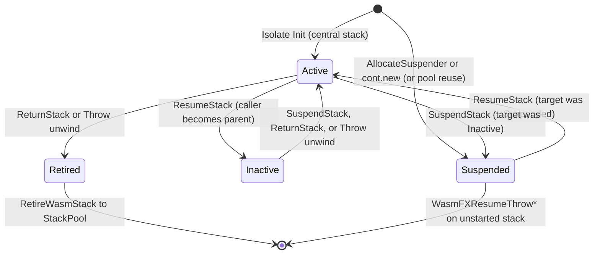
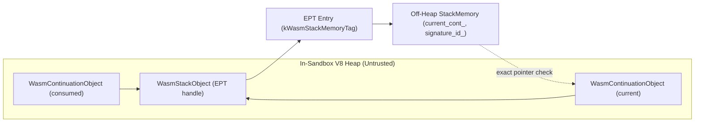

# WebAssembly Stack Switching (JSPI & WasmFX)

V8 implements two WebAssembly stack-switching proposals on one shared off-heap engine: **JavaScript Promise Integration (JSPI)** (shipped by default in `src/wasm/wasm-features.h`, bridging synchronous Wasm with asynchronous JS `Promise`s via `WebAssembly.Suspending` and `WebAssembly.promising`) and **WasmFX / Core Stack Switching** (`--wasm-wasmfx` in `src/flags/feature-flags.h`, experimental pure-Wasm typed delimited continuations and effect handlers).

## Conceptual Overview

Unlike JS `async` functions and generators (where Ignition copies a single bytecode frame into a `JSGeneratorObject`), Wasm suspends arbitrarily deep native call chains holding unboxed scalars, 128-bit SIMD values, and WasmGC references. Heap-allocating frames or CPS-transforming every call would penalize non-suspending code and break V8's native frame-pointer ABI. Instead, V8 runs suspendable Wasm on off-heap **secondary stacks** (`wasm::StackMemory`), saving and restoring only boundary registers (`sp`, `fp`, `pc`, `stack_limit`) in an off-heap `wasm::JumpBuffer` while interior frames stay untouched in place.

| Dimension | JSPI (Always Enabled) | WasmFX (`--wasm-wasmfx`) |
|---|---|---|
| **Control-flow model** | Asymmetric host-boundary suspension between a `promising` export and a `Suspending` import returning a JS `Promise`. | Pure-Wasm typed delimited continuations with tag handlers (`resume*` / `suspend`) and peer-to-peer `switch`. |
| **Compiler tiers** | Both **Liftoff** and **Turboshaft** execute on JSPI stacks. | Both **Liftoff** and **Turboshaft** execute on secondary WasmFX stacks; **Turboshaft only for WasmFX opcodes** (`LiftoffCompiler` bails out with `kWasmfx`, hitting `UNIMPLEMENTED()` under `--liftoff-only` to avoid spurious fuzzer reports, while functions that only pass `cont` values still compile in Liftoff). |
| **Heap representation** | Trusted-space `WasmSuspenderObject` (`ExposedTrustedObject`), plus `WasmResumeData` and `WasmSuspendingObject`. | In-sandbox two-object split: single-use `WasmContinuationObject` tokens pointing `N:1` to a `WasmStackObject` wrapping an EPT handle (`kWasmStackMemoryTag`). |
| **Boundary frames** | `StackFrame::WASM_JSPI` at parent exit and child base/suspend boundaries. | `StackFrame::WASM_STACK_ENTRY` at child base and `StackFrame::WASM_STACK_EXIT` at switch sites. |
| **Resumption linearity** | Resumed once when the awaited `JSPromise` settles (`WasmResume` / `WasmReject`). | **Spec-mandated one-shot affine**: each `cont.new`, `cont.bind`, `suspend`, and `switch` mints a fresh token and invalidates prior tokens via `StackMemory::current_cont_`. |

## 1. Off-Heap Stack Infrastructure (`src/wasm/stacks.h`, `src/wasm/stacks.cc`)

### `StackMemory`, Guard Pages, and `StackPool`
`Isolate::wasm_stacks()` tracks all live stacks: index `0` is a non-owning view of the main OS (or simulator) stack, and owned secondary stacks store their vector index (`index_`) for `O(1)` swap-and-pop removal in `Isolate::RetireWasmStack`. Each owned `StackMemory` is a doubly linked list of page-aligned `StackSegment`s (whose writable payload `[limit_, limit_ + size_)` is registered as sandbox extension memory under `V8_ENABLE_SANDBOX_HARDWARE_SUPPORT`) flanked by `kNoAccess` guard pages:

```text
Higher Virtual Addresses
+-------------------------------------------------------------------+
| Guard Page (1 OS page, PageAllocator::kNoAccess)                  |
+===================================================================+ <-- segment->base() (limit_ + size_)
| Writable Stack Payload (PageAllocator::kReadWrite, size_ bytes)   |
|                  |  Frames grow downward (sp)                     |
|                  v                                                |
+-------------------------------------------------------------------+ <-- stack->jslimit()
| Stack Limit Margin (StackMemory::JSGrowableStackLimitMarginKB())  |
+===================================================================+ <-- segment->limit_ / stack->limit()
| Guard Page (1 OS page, PageAllocator::kNoAccess)                  |
+-------------------------------------------------------------------+
Lower Virtual Addresses
```

- **Sizing and stack-limit margin**: Initial segment size adds `--wasm-stack-switching-stack-size` and `StackMemory::JSGrowableStackLimitMarginKB()`, capped by `--stack-size` and rounded to allocation-page size. Under `--wasm-growable-stacks`, `JSGrowableStackLimitMarginKB()` still reserves a margin above the worst-case outgoing Wasm stack arguments (`kV8MaxWasmFunctionParams * kMaxValueTypeSize`) for historical reasons, even though function-entry stack checks now account for outgoing stack parameters.
- **Deferred destruction and zapping (`StackPool::Add`)**: A stack is retired while execution or unwinding still runs on it (and while `WasmFXReturn` passes a `result_buffer` inside the retiring stack to its parent). `StackPool::Add` therefore only calls `StackMemory::Reset()` and appends to `freelist_` with pages intact. Eviction to `--wasm-stack-pool-capacity-mb` and `DEBUG` zapping run lazily on the next `StackPool::GetOrAllocate()`, or in `Heap::GarbageCollectionEpilogueInSafepoint` when a memory-reducing major GC calls `ReleaseFinishedStacks()`.

### Segmented Growable Stacks (`--wasm-growable-stacks`)
- **Segmented growth**: `--wasm-growable-stacks` starts secondary stacks small and chains `StackSegment`s up to `--stack-size`. When a function-entry stack check overflows (lowered by `GrowableStacksReducer` in Turboshaft and by Liftoff), `wasm::grow_stack` grows or reuses a segment via `StackMemory::Grow`, copies the incoming stack parameters and frame header to the new segment (valid at function entry because those slots contain no self-references), and patches the copied caller PC to `Builtin::kWasmReturnFromSegment`.
- **Return trampoline and segment retention**: Returning from the segment's root frame enters `Builtin::kWasmReturnFromSegment` -> `wasm::shrink_stack`, copying stack return slots back to the parent segment and restoring `sp`, `fp`, and the stack limit (avoiding a dedicated segment-start frame type; stack walking resolves the trampoline via `TypedFrame::UnwindWasmReturnFromSegment`, and unwinding drops segments via `StackMemory::ShrinkTo`). `Shrink()` rewinds `active_segment_` while retaining `next_segment_` for reuse on subsequent `Grow()` calls (dropping a cached segment only if too small for the next evicted frame).

### `JumpBuffer` and Sandbox `StackState` Machine
Each `StackMemory` embeds a `JumpBuffer` (`sp`, `fp`, `pc`, `stack_limit`, `parent`, `is_on_central_stack`, `state`). All live transitions flow through `Isolate::SwitchStacks` (`src/execution/isolate.cc`):



- **Parent-chain splicing**: Resuming splices the tail of the target's `parent` chain onto the caller so multi-stack continuations resume as a unit; suspending or returning severs `parent = nullptr` so the detached chain stays self-contained.
- **Sandbox enforcement (`SBXCHECK_EQ`)**: `Isolate::SwitchStacks` checks both outgoing (`Active`) and expected target `StackState` before `LoadJumpBuffer` pivots hardware stack registers. Corrupted or aliased in-sandbox handles cannot resume an `Active`, `Inactive`, or `Retired` stack; keeping `Suspended` distinct from `Inactive` is free and hardens against calling-convention changes.

## 2. Central-Stack Switching & Platform Microarchitecture

- **Why JS and C++ run on the central stack**: JS tiers, C++ `RUNTIME_FUNCTION`s, GC, and OS libraries assume execution on the thread's main OS stack (`CentralStack`) and cannot suspend across JS/C++ frames. Wasm-to-JS imports (`BuildSwitchToTheCentralStackIfNeeded`) and Wasm-to-C++ `CEntry` calls from a secondary stack temporarily switch `sp` back to `central_stack_sp_`, tracked by `is_on_central_stack_flag_` (with nested central -> secondary switches saved in `StackMemory::central_stack_sp_`).
- **Frame split and single-`StackSwitchInfo` invariant**: Wasm-to-JS wrappers switch `sp` *after* building the frame header on the secondary stack, so spill slots stay on the secondary stack while outgoing stack parameters live on the central stack. `StackMemory::stack_switch_info_` stores `(source_fp, target_sp)` so `WasmFrame::Iterate` and `TypedFrame::Iterate` cap parameter scanning at `target_sp`. One `StackSwitchInfo` per stack suffices because a stack cannot suspend while on the central stack. Under `V8_ENABLE_SANDBOX_HARDWARE_SUPPORT` or native Windows, the switch runs via a C call because sandboxed generated code cannot write off-heap `StackMemory` and Windows must update the TEB.
- **Windows TEB bounds (`V8_OS_WIN`)**: Native Windows SEH, `_chkstk`, and system DLLs require `rsp` within `[TEB->StackLimit, TEB->StackBase]`. `Isolate::Init` caches the central stack base upfront; `StackMemory` saves the central stack's committed `TEB->StackLimit` before leaving the central stack, updates TEB bounds across secondary switches and segment growth/shrinking, and restores the saved central bounds on return or unwind so `_chkstk` never probes live caller frames.
- **Lock-free stack-limit updates (`StackGuard::SetStackLimitForStackSwitching`)**: Stack switches avoid the `ExecutionAccess` mutex by updating `jslimit_` with `Relaxed_CompareAndSwap(&jslimit_, real_jslimit_, limit)` and unconditionally writing the main-thread-owned `real_jslimit_`. A concurrent `kInterruptLimit` causes the CAS to fail and preserves the pending interrupt for the next stack check.
- **Hardware RSB synchronization on x64/ia32 (`Builtins::BypassesReturnAddressPrediction`)**: Calling `WasmFXResume*`, `WasmFXSuspend`, or `WasmFXSwitch` with `call` pushes the caller's return address onto the CPU Return Stack Buffer (RSB), which the target stack's `ret` pops, guaranteeing an RSB misprediction on every switch. On non-CET x64/ia32, callers push the return address and jump without touching the RSB, and the builtin returns via an indirect jump -- using the indirect branch predictor and keeping outer RSB entries aligned on call-balanced slices. Disabled under Intel CET (IBT needs `endbr64`; shadow stacks require matched `call`/`ret`).

## 3. Heap Objects & V8 Sandbox Design

- **Trusted-space JSPI (`WasmSuspenderObject`)**: `WasmSuspenderObject` lives in `TrustedSpace` (`ExposedTrustedObject`), storing `stack_`, protected `parent_`, `promise_`, and `resume_`/`reject_` closures backed by `WasmResumeData`. `Isolate::WasmInitJSPIFeature()` installs a root sentinel `WasmSuspenderObject` (`has_parent() == false`) in `IsolateData::active_suspender_` for the central stack. `WasmSuspendingObject` marks imported JS callables so instantiation compiles a suspending `WasmToJSWrapper`.
- **In-sandbox WasmFX two-object split (`WasmContinuationObject` vs. `WasmStackObject`)**: WasmFX continuations are first-class Wasm values stored in untrusted tables, globals, and GC structs, so V8 places them in-sandbox and validates every use against trusted off-heap `StackMemory`. A stack suspends many times and mints a fresh young-gen `WasmContinuationObject` on each step; giving every token its own EPT entry would incur EPT allocation and GC overhead. Sharing one `WasmStackObject` per stack deduplicates the EPT entry (`kWasmStackMemoryTag`) at the cost of one pointer indirection.



- **Retirement safety (`ExternalPointerTable::ManagedResource`)**: Under `V8_COMPRESS_POINTERS`, `StackMemory` inherits from `ExternalPointerTable::ManagedResource` so `Isolate::RetireWasmStack` clears the EPT entry purely from off-heap state (`ClearExternalPointerTableEntry()`). Reading the handle back from in-sandbox `WasmStackObject::stack_` would let an attacker swap it before retirement and leave the original EPT entry dangling (UAF).
- **Off-heap validation (`CheckContAndGetStack`)**: Every continuation-consuming opcode checks nullness and non-zero EPT resolution, then verifies two off-heap fields without trusting in-sandbox object layouts: exact pointer equality against `StackMemory::current_cont_` (enforcing spec-mandated one-shot linearity) and exact equality against `StackMemory::signature_id_` (`CanonicalTypeIndex`, valid because spec continuation types are invariant and non-castable, preventing register or argument-buffer type confusion).

## 4. Stack Frames, Effect Handlers, and Interop Boundaries

Active stacks form a `JumpBuffer::parent` chain rooted at the central stack (`wasm_stacks()[0]`):

```text
  Central Stack (Inactive)       JSPI Stack (Inactive)          WasmFX Stack A (Inactive)      WasmFX Stack B (Active)
  +----------------------+       +----------------------+       +----------------------+       +----------------------+
  | JS / Entry Frames    |       | WASM_JSPI (fp=0)     |       | WASM_STACK_ENTRY (0) |       | WASM_STACK_ENTRY (0) |
  | ...                  |       | Wasm Frame (resume)  |       | Wasm Frame (resume)  |       | Wasm Frames ...      |
  | WASM_JSPI (Exit)     |       | WASM_STACK_EXIT      |       | WASM_STACK_EXIT      |       | (running)            |
  +----------------------+       +----------------------+       +----------------------+       +----------------------+
                 ^                   |          ^                   |          ^                   |
                 +-- jmpbuf.parent --+          +-- jmpbuf.parent --+          +-- jmpbuf.parent --+
```

- **Cross-stack walking (`StackFrameIterator`)**: JSPI uses `WASM_JSPI` on both sides of a switch (child base frames have `caller_fp == kNullAddress`); WasmFX uses `WASM_STACK_ENTRY` at the child base and `WASM_STACK_EXIT` at switch sites. Unless `FirstStackOnly{}` is set, reaching a child base frame hops to `jmpbuf()->parent` (`CHECK`ing `Inactive`) and resumes at the parent's exit frame.
- **One frame per stack for effect-handler search (`find_wasmfx_handler_stack`)**: By spec, effect handlers attach only to `resume*` instructions (never to regular calls). In V8, each `resume*` immediately pushes `WASM_STACK_EXIT` and switches stacks, so searching ancestors is `O(nested stacks)`: for each `WASM_STACK_EXIT`, its immediate `WASM` caller holds the handler table. `PrepareResume` pre-caches that caller's `WasmCode*` in `StackMemory::wasm_code_` (kept alive by the frame, cleared on return/suspend) to avoid a code-table lookup.
- **Interop boundaries (JSPI <-> WasmFX)**: Neither JSPI nor WasmFX allows suspending across host JS or C++ frames. WasmFX `suspend`/`switch` traps inline on `is_on_central_stack_flag_`; `find_wasmfx_handler_stack` stops *before* any `WASM_JSPI` frame and checks `to->jmpbuf()->is_on_central_stack` *after* scanning `to`'s own handlers (allowing a central-stack `resume*` to match, while blocking search past outer JS/C++ frames). Conversely, a JSPI `Suspending` import inside WasmFX checks `old_sp` and `wasm::suspender_has_js_frames` across the active stack chain up to the enclosing suspender's parent; if clean, JSPI detaches and later resumes the entire nested WasmFX chain as one unit.

## 5. Execution Flows & Argument Buffers

### JSPI Flow (`promising` & `Suspending`)
- **Entry**: `WebAssembly.promising` allocates a `WasmSuspenderObject` (`JSPromise` + `WasmResume`/`WasmReject` closures) and a pooled `StackMemory`, then switches to the secondary stack to call the export.
- **Suspend**: A `Suspending` import runs on the central stack, coerces its return value to a `Promise`, attaches `resume`/`reject` (notifying Promise hooks/DevTools if active), restores `active_suspender_ = parent_`, and returns `suspender->promise()`.
- **Resume, reject, or return**: Settling the awaited `Promise` resumes or throws on the suspended stack; normal completion retires the stack and fulfills `suspender->promise()`.

### WasmFX Argument Buffers & Instruction Contracts
- **Right-to-left `IterateWasmFXArgBuffer` (`src/wasm/stacks.h`)**: Parameters, bound arguments, tag payloads, and multi-value returns are packed right to left (uncompressed tagged refs). Because slot `i`'s offset depends only on the unbound suffix `types[i .. N-1]`, `cont.bind` writes bound prefix arguments to their final offsets once, and later `cont.bind`/`resume`/`switch` calls write remaining suffix arguments from offset `0` without shifting.
- **`cont.new` (`Runtime_WasmAllocateContinuation`)**: Null-checks `WasmFuncRef`, allocates a pooled `StackMemory`, `WasmStackObject`, and `WasmContinuationObject`, reserves `arg_buffer_` below `stack->base()`, sets `jmpbuf.pc` to a cached `WasmStackEntryWrapper` (`fp = kNullAddress`, `state = Suspended`), and appends to `wasm_stacks()` only after initializing references so a mid-init GC cannot mark an empty stack clean.
- **`cont.bind`**: Validates via `CheckContAndGetStack`, inline-allocates a new `WasmContinuationObject` sharing `stack_obj_` (even for zero args, preserving one-shot affinity), lazily populates `param_types_` from `signature_id_` on the first non-zero bind (avoiding a `TypeCanonicalizer` lookup on every `suspend`/`switch`, since `param_types_` is only needed by `IterateWasmFXRoots` for bound references), updates off-heap `num_bound_args_`, `signature_id_`, and `current_cont_`, and stores the bound prefix into `arg_buffer_`.
- **`resume*` & `WasmCode::effect_handlers()`**: Validates the target, caches `active_stack->wasm_code_`, attaches compact handler metadata to `WasmCode::effect_handlers()` (translated between canonical and module-relative IDs in `src/wasm/wasm-serialization.cc`), and `__ Retain`s `cont_ref` across the call to ensure the external stack pointer is not freed prematurely. First resumption enters `WasmStackEntryWrapper` and retires the stack on return; `resume_throw*` on an unstarted stack (`fp == kNullAddress`) retires it immediately and throws on the caller stack.
- **`suspend`**: Traps if on the central stack, inline-allocates a fresh token, packs tag args into a stack buffer, and searches via `find_wasmfx_handler_stack`. On match, V8 redirects the handler stack's `JumpBuffer` directly to the handler block (bypassing its `WASM_STACK_EXIT` frame), records suspended metadata on `from`, and suspends to the handler.
- **Peer-to-peer `switch`**: Transfers directly to a target continuation under an enclosing `(on $tag switch)` prompt without bouncing through the prompt frame. After validating the target and packing payload args plus the newly minted return continuation into `target_stack->arg_buffer_`, `switch_wasmfx_stack` locates the prompt `parent` (leaving `parent->jmpbuf()` unchanged) and runs `SuspendStack(from -> parent)` followed immediately by `ResumeStack(parent -> target_stack)`.

## 6. GC, Unwinding, and Sampling Profiler Invariants

- **Heap roots & Wasm Code GC**: `Isolate::Iterate` visits `active_suspender_` and all stacks in `wasm_stacks()`, using `FirstStackOnly{}` on the active stack to avoid double-visiting `Inactive` parents; `IterateWasmFXRoots` visits `current_cont_`, `func_ref_`, `stack_obj_`, and bound reference slots in `arg_buffer_` (cleared on resume/switch). `WasmEngine::ReportLiveCodeFromStackForGC` walks `wasm_stacks()` identically and retains `WasmStackEntryWrapper` for unstarted WasmFX stacks via `jmpbuf()->pc`.
- **Minor-GC skip (`contains_only_old_pointers_`)**: To avoid rescanning immutable suspended stacks on every minor GC, `StackMemory` skips clean stacks in `O(1)` during young-generation GCs (checked by `VerifyNoYoungPointersVisitor` in `DEBUG`). Non-young visitors set this flag **only** during `Heap::MARK_COMPACT` (after which young space is empty), preventing non-evacuating walks like `Heap::Verify` from falsely marking stacks clean while young pointers remain. Dirtied on switch-out, `set_current_continuation`, `cont_bind`, and `Reset()`.
- **Cross-stack exception unwinding (`Isolate::UnwindAndFindHandler`)**: A JS-catchable exception reaching `WASM_JSPI` (except under `--stress-wasm-stack-switching`) lands at the JSPI prompt handler to reject `suspender->promise()`. Intermediate stacks are retired only in `FoundHandler` *after* locating the handler so `ThreadLocalTop` stays consistent during iteration; handlers on a secondary stack call `ShrinkTo`, clear `is_on_central_stack_flag_` and `stack_switch_info()`, and restore stack-limit and Windows TEB bounds.
- **Signal-safe sampling profiler**: During `SIGPROF` (`TickSample::GetStackSample` and `StackFrameIteratorForProfiler`; see [Stack Walking and Frame Layouts](../runtime/stack-walking.md)), V8 sets `js_entry_sp = stack->base()` when on a secondary stack (`parent != nullptr`). `StackFrameIteratorForProfiler` enforces monotonic bounds within the active segment and stops at the segment base without chasing off-heap `JumpBuffer::parent` links asynchronously.

## 7. Key Source Files

| File | Role |
|---|---|
| `src/wasm/stacks.{h,cc}` | `StackMemory`, `StackSegment`, `StackPool`, `JumpBuffer`, `IterateWasmFXArgBuffer`, TEB bounds, and GC root/minor-GC tracking. |
| `src/wasm/wasm-objects.{tq,h,cc}` | `WasmSuspenderObject`, `WasmResumeData`, `WasmSuspendingObject`, `WasmContinuationObject`, and `WasmStackObject`. |
| `src/wasm/turboshaft-graph-interface.{h,-inl.h,cc}` | Turboshaft lowering for WasmFX opcodes, `CheckContAndGetStack`, and central-stack switches. |
| `src/compiler/turboshaft/wasm-wrappers.{h,-inl.h,cc}` | JSPI `BuildSuspend`, `WasmToJSWrapper` central-stack checks, and `BuildWasmStackEntryWrapper`. |
| `src/wasm/wasm-external-refs.cc`, `src/runtime/runtime-wasm.cc` | C++ stack-switching helpers (`find_wasmfx_handler_stack`, `grow_stack`/`shrink_stack`, `Runtime_WasmAllocate*`). |
| `src/execution/isolate.cc`, `src/execution/stack-guard.cc` | `Isolate::SwitchStacks`, `RetireWasmStack`, cross-stack `UnwindAndFindHandler`, and lock-free `SetStackLimitForStackSwitching`. |
| `src/execution/frames.{h,cc}`, `src/builtins/builtins.h`, `src/profiler/tick-sample.cc` | Boundary frame types, cross-stack/profiler iteration, segment-return unwinding, and RSB bypass predicate. |
